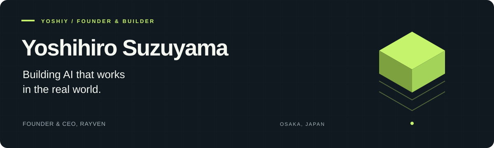

  <a href="https://rayven.co.jp/">RAYVEN</a> &nbsp; / &nbsp;
  <a href="https://www.tumiki.cloud/">Tumiki</a> &nbsp; / &nbsp;
  <a href="https://worklens-ai.com/">WorkLens AI</a> &nbsp; / &nbsp;
  <a href="https://www.wantedly.com/id/yoshihiro_suzuyama">Wantedly</a>

## Technology that works where it matters.

**Yoshihiro Suzuyama / yoshiy** · Founder & CEO at RAYVEN · Osaka, Japan

I started building software and improving workflows while working as a radiologic technologist. In 2024, I founded RAYVEN. Today, I build products that help companies put AI to work safely in their everyday operations.

I care about the impact people can see in their work. My approach is to understand the problem, build a solution, and test it with the people who use it.

### What I'm building

<table>
<tr>
<td width="50%" valign="top">
<h3><a href="https://www.tumiki.cloud/">Tumiki ↗</a></h3>

<strong>Governance for AI agents</strong>

Identity, permissions, and activity records for AI agents. Tumiki manages connections to internal systems through MCP, helping companies define what their agents can access and do.

AI Governance / MCP / Access Control
</td>
<td width="50%" valign="top">
<h3><a href="https://worklens-ai.com/">WorkLens AI ↗</a></h3>

<strong>Real work, captured as context for AI</strong>

Understand workflows from measured activity, identify work that AI can take on, and evaluate its impact. WorkLens AI provides the context agents need to understand how work gets done.

Work Analytics / Context / AI Adoption
</td>
</tr>
</table>

### Background

**Healthcare → Software & workflow improvement → RAYVEN**

- Graduated from Fujita Health University and worked as a radiologic technologist at Kansai Medical University Hospital.
- Started building software and running an independent business while at university; founded RAYVEN in 2024.
- Help organize the Osaka chapter of an AI-driven development community and speak about MCP and practical AI adoption.

### Recognition

Selected awards received by RAYVEN and its products.

| Year | Award |
| :--- | :--- |
| 2026 | **Shido Next Innovator** — Top Award, Demo Day |
| 2026 | **Business Model Award 2026** — Top Award |
| 2025 | **Mirai no Pitch 2025** — NICT Award & Kinki Bureau of Telecommunications Director-General Award |

[See all awards →](https://rayven.co.jp/awards)

### Tools I build with

Public repositories

 

| Repository | About |
| :--- | :--- |
| [claude-code-analytics](https://github.com/yoshiy-dev/claude-code-analytics) | A Next.js app with usage analytics and reporting features |
| [bodyscan](https://github.com/yoshiy-dev/bodyscan) | A web app built with Next.js, Prisma, and tRPC |
| [marp](https://github.com/yoshiy-dev/marp) | A Marp template for creating slides with Markdown and CSS |

---

<strong>Let's connect over practical AI, product development, and community.</strong> 
<a href="https://rayven.co.jp/">Explore what we're building at RAYVEN →</a>

